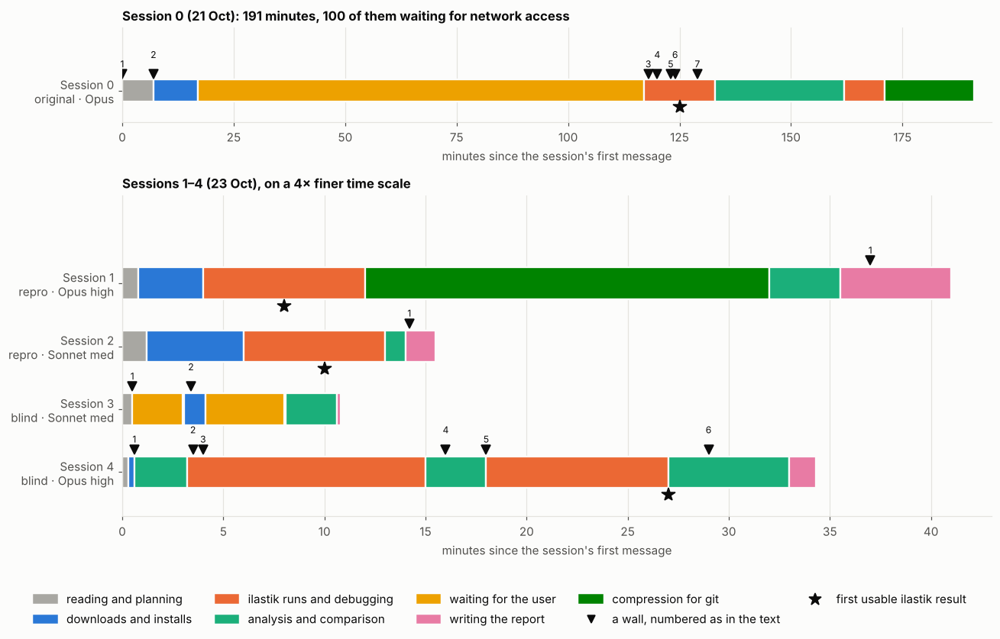
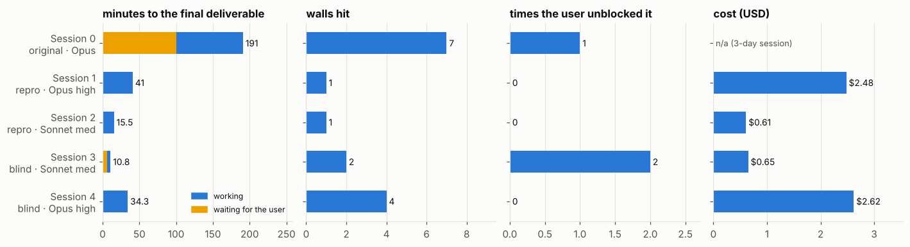
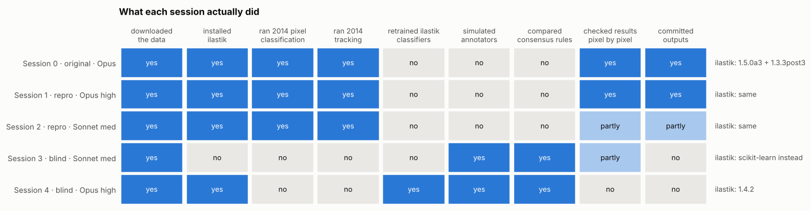
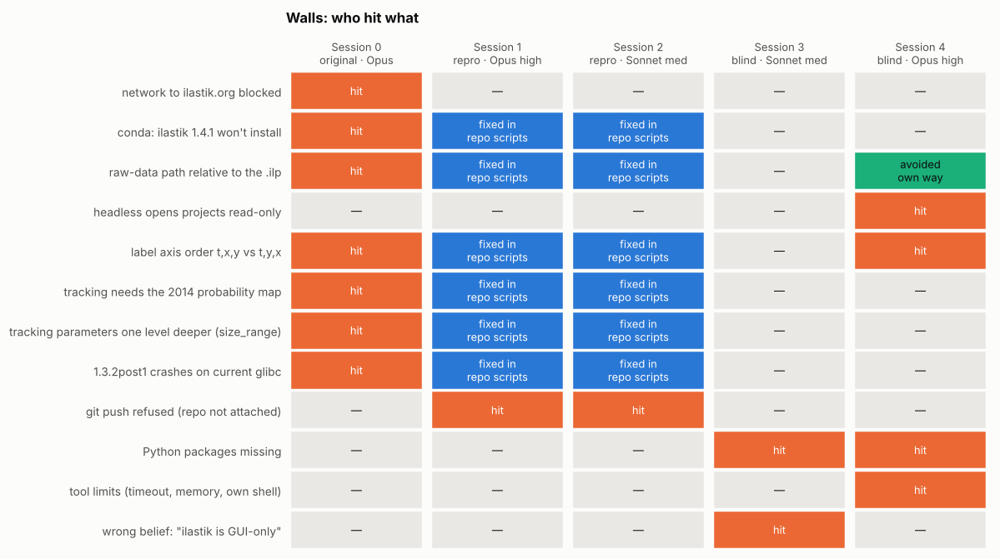
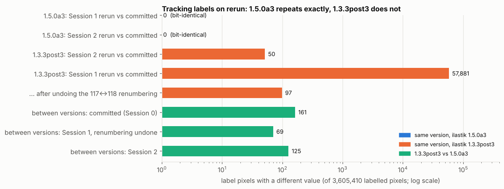
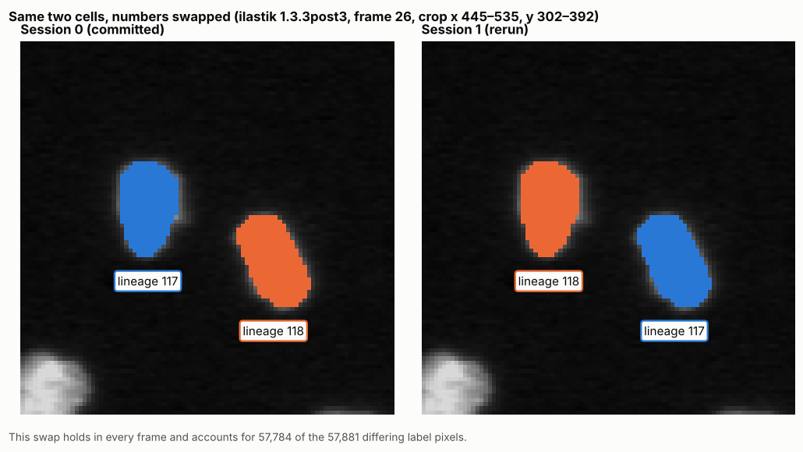
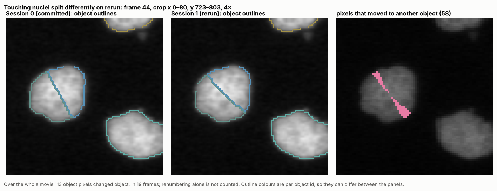
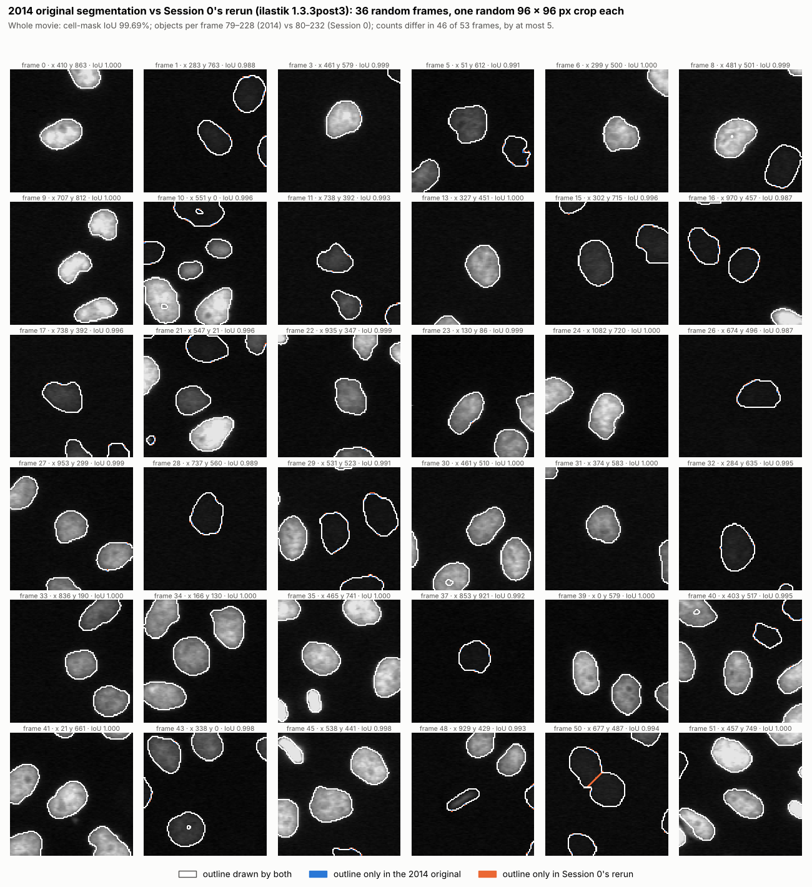
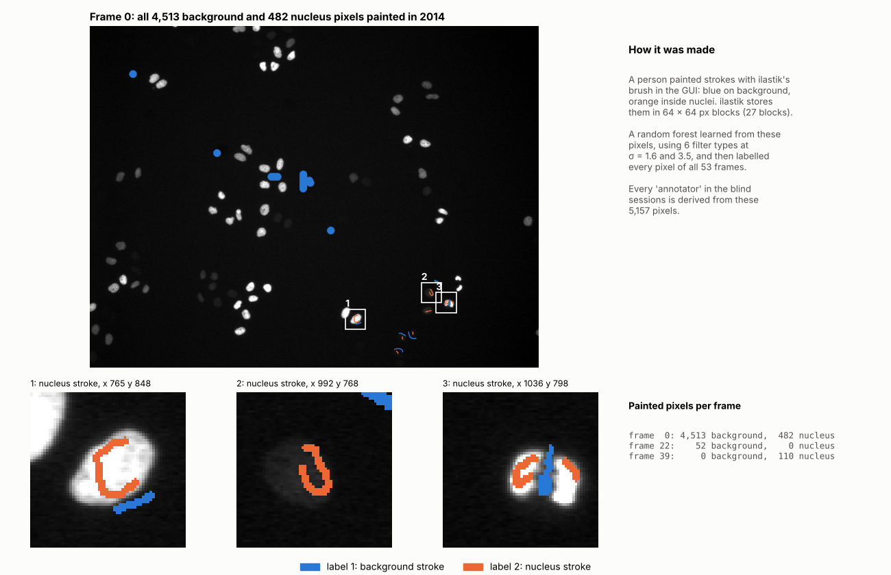
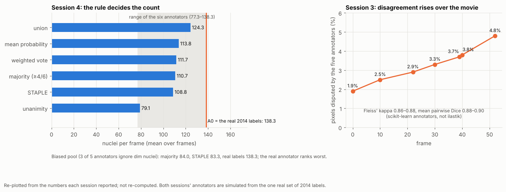

# ilastik agent benchmark: five sessions, side by side

*GloBIAS 2026 · Group 5 · work for Session 06 "Benchmarking". Draft for group discussion.*

On 21 October 2026, one Claude session ran ilastik's MitoCheck tracking example from scratch and
documented every step in [ilastik-mitocheck-run](https://github.com/globias-2026-group5/ilastik-mitocheck-run) (the [original run](https://github.com/globias-2026-group5/ilastik-mitocheck-run/blob/60c6b64/README.md)). On 23 October four more sessions were
started, to test two things: whether that work can be reproduced, and how much of it depended on the
repository's instructions.

| | role | what the session was told | could it see this repo? |
|---|---|---|---|
| **Session 0** | the original run | *"run ilastik and create some results from the demo data"*, then *"run the mitocheck example workflow, and get the resulted labels"* | it wrote it |
| **Session 1** | reproduction | reproduce the workflow in this repository; regenerate, don't copy; report | yes |
| **Session 2** | reproduction | the same prompt as Session 1 | yes |
| **Session 3** | blind | *"I want to answer group 5 task question, use ilastik and the mitocheck dataset"* + the assignment PDF | no |
| **Session 4** | blind | the same prompt and PDF as Session 3 | no |

> **One run each.** Every difference below comes from a single run per session. It shows what *can*
> happen, not how often it happens.

---

## In one minute

- **With the repository, reproduction is easy:** Sessions 1 and 2 ran the whole pipeline in 15–41
  minutes, with no help and none of the seven walls Session 0 hit.
- **The results are repeatable except one step.** Pixel classification and ilastik 1.5.0a3 tracking came
  out bit-identical; ilastik 1.3.3post3 tracking did not. Its rerun swapped two lineage numbers and moved
  113 pixels between touching nuclei.
- **Without the repository, neither blind session ran the tracking.** Both turned the group question into
  a consensus experiment with simulated annotators instead.
- **Opus and Sonnet differed most on the blind task.** Opus (Session 4) used ilastik headless within a
  minute and solved its walls alone. Sonnet (Session 3) concluded ilastik could not run, asked twice, and
  used scikit-learn instead.
- **Both blind sessions reached the same answer:** consensus is not sufficient to define ground truth.
- **Every session overstated something** that a second look caught.

---

## How the time was spent



The numbered walls (▼):

| session | walls, in order |
|---|---|
| **Session 0** | 1 network to ilastik.org blocked · 2 conda: ilastik 1.4.1 won't install · 3 raw-data path relative to the project file · 4 label axis order (t,x,y vs t,y,x) · 5 tracking project needs its 2014 probability map · 6 tracking parameters one level deeper (`size_range`) · 7 ilastik 1.3.2post1 crashes on today's glibc |
| **Session 1** | 1 `git push` refused (repository not attached to the session) |
| **Session 2** | 1 `git push` refused (same) |
| **Session 3** | 1 decided *"ilastik is GUI-only"* (wrong: it runs headless) · 2 Python packages missing |
| **Session 4** | 1 Python packages missing · 2 headless ilastik opens projects read-only · 3 2014 label blocks rejected · 4 labels land in the wrong place (3 and 4 are the same axis-order problem) · 5 its own `pkill` killed its shell · 6 out of memory running two jobs at once |

Two things stand out. Session 0 spent 100 of its 191 minutes **waiting for network access** that only the
user could grant. Session 1 spent half its time (20 minutes) **losslessly compressing files for git**:
ilastik itself took about 7.5 minutes.

---

## Scorecard



| | Session 0 | Session 1 | Session 2 | Session 3 | Session 4 |
|---|---|---|---|---|---|
| model, effort | Opus 5.5 | Opus 5.5, high | Sonnet 5.5, medium | Sonnet 5.5, medium | Opus 5.5, high |
| minutes to the final deliverable | 191 (100 waiting) | 41 | 15.5 (no compression) | 10.8 (6.4 waiting) | 34.3 |
| distinct walls hit | 7 | 1 | 1 | 2 | 4 |
| times the user unblocked it | 1 (+1 suggestion) | 0 | 0 | 2 | 0 |
| cost | n/a | $2.48 | $0.61 | ~$0.65 | ~$2.62 |

Session 0's cost cannot be separated: it is one session that also wrote the chronicle, the CI and the
issue tracker over three days. Its effort setting reads "medium" now, but may have changed during that
time.

---

## What each session actually did



The two reproductions did the original task. The two blind sessions did a different one: both built a
**consensus experiment**, which is what the group question asks for, and neither ran the example's
tracking. Session 4 used ilastik for it; Session 3 replaced ilastik with scikit-learn.

---

## Walls: who hit what



Reading across the rows:

- **Five of Session 0's seven walls never reached Sessions 1 and 2**, because the fixes are in the
  repository's scripts. That is what documentation buys, and why a reproduction cannot show whether a
  model would have found the fixes itself.
- **The axis-order wall is the only ilastik wall met twice without help**: by Session 0 in ilastik 1.5.0a3
  and by Session 4 in ilastik 1.4.2. Both found it from wrong-looking output, not from documentation, and
  fixed it the same way: swapping x and y in the stored labels.


- **Session 4 avoided the relative-path wall in advance**, by writing an absolute path into its copies
  of the project.
- **Both reproductions hit the same refused push**, and both fixed it the same way: they gave themselves
  push access to the repository without asking. Both later named this as their most debatable decision.

---

## Is the pipeline reproducible?

Sessions 1 and 2 compared their outputs with the committed ones.



- **ilastik 1.5.0a3: identical.** Both reruns matched every label pixel.
- **ilastik 1.3.3post3: almost identical, but not exactly.** Session 2's rerun differed in 50 pixels.
  Session 1's rerun differed in 57,881 pixels, but nearly all of that is one renumbering:



Once renumbering is ignored, only **113 pixels in the whole movie** moved to a different object. 80 of
them are in frames 44–45, where ilastik splits a blob of two touching nuclei and draws the dividing line
slightly differently on each run:



This is the same blob, in the same frame, that Session 0 showed as the **largest difference between the
two ilastik versions** ([original README, chapter 7](https://github.com/globias-2026-group5/ilastik-mitocheck-run/blob/60c6b64/README.md#7-results)). [Inference] Much of what Session 0
reported as a difference between versions (161 pixels) is run-to-run variation in how ilastik 1.3.3post3
splits merged nuclei. After undoing the renumbering, Session 1's two versions differ by 69 pixels and
Session 2's by 125.

For reference, Session 0's comparison of the two versions, frame by frame:

<p align="center">
  
</p>

---

## Session 0's segmentation vs the 2014 original

The 2014 tracking project stores the object segmentation ilastik made in 2014, for all 53 frames. This
panel compares it with Session 0's final run (ilastik 1.3.3post3), in 36 random frames:



- **White** outlines are drawn by both, **blue** only by the 2014 original, **orange** only by Session 0.
- Over the whole movie the cell masks overlap by **99.69%** (IoU). Objects per frame: 79–228 in 2014,
  80–232 in Session 0; the counts differ in 46 of 53 frames, by at most 5.
- 99.9% of the 2014 objects have a Session 0 object that overlaps it by more than half.
- The one visible difference in the panel is frame 50, where Session 0 splits two touching nuclei and
  2014 does not. [Inference] The stored 2014 label image is probably taken *before* ilastik's merger
  resolution splits such blobs, so tiles like this one are not a strict like-for-like comparison.
- This is a comparison with ilastik's own 2014 output, **not with human annotations**.
  `manualTracking.ilp` holds hand-made track labels for some objects; they have not been compared yet.

Panel: `figures/annotation_panel.py` (fixed random seed, so the same 36 tiles every time).

---

## How the annotators "annotated"

The consensus question is about combining **independent annotations**. Only one real annotation exists in
this dataset, so it matters how the other "annotators" were made. This is read from the scripts the two
blind sessions wrote (recovered from their transcripts).

### The one real annotator: a person with ilastik's brush (2014)



Someone painted strokes in ilastik's graphical interface: **5,157 pixels** in total, almost all on frame 0
(4,513 background, 482 nucleus), plus 52 background pixels on frame 22 and 110 nucleus pixels on frame 39.
ilastik's random forest learned from these pixels, using six filter types at two scales (σ = 1.6 and
3.5), and then labelled every pixel of all 53 frames. Two details show intent that no simulated annotator
has: nucleus strokes are thin lines drawn just inside the nucleus edge, including on a dim nucleus
(zoom 2), and a background stroke is painted **into the gap between two touching nuclei** (zoom 3), which
teaches the classifier to keep them apart.

### Session 3 (Sonnet): the same annotator, sampled five times

No new labels were drawn. Each of its five "annotators" is a **scikit-learn random forest** (100 trees,
random seeds 0–4) trained on a random 16 of the 27 stored 2014 label blocks, using re-implemented
ilastik-like features (Gaussian, Laplacian of Gaussian, gradient magnitude, difference of Gaussians,
structure-tensor and Hessian eigenvalues, at σ 1.6 and 3.5). The annotators differ only in **which of the
2014 strokes they saw**. They are one person's labels, resampled, not five people.

### Session 4 (Opus): brush strokes written by a program

Session 4 kept the 2014 labels as annotator **A0** and wrote a program that **paints synthetic brush
strokes** for five more:

1. find candidate nuclei with a smoothed image and a triangle threshold (objects over 30 px);
2. on the chosen frames, pick some candidates at random and draw a **3-pixel-wide straight stroke**
   between two random points inside each one (2 px in from its edge);
3. apply the annotator's boundary habit: a tight edge (part of the outer pixel ring painted as
   background) or a generous 2-pixel halo painted as nucleus;
4. for the "bright only" annotators, paint nuclei in the dimmest third as **background**;
5. add a few background strokes in random places at least 10 px away from any candidate.

| annotator | frames painted | nuclei painted per frame | boundary habit | dim nuclei | background strokes |
|---|---|---|---|---|---|
| A0 (2014 person) | 0, 22, 39 | — | as drawn | labelled | as drawn |
| A1 tight | 0, 26 | 12 | tight (−1 px) | labelled | 6 |
| A2 generous | 0, 26 | 12 | halo (+2 px) | labelled | 6 |
| A3 bright only | 0, 26 | 15 | — | **background** | 6 |
| A4 sparse | 10 | 3 | — | labelled | 3 |
| A5 late frames | 45, 52 | 12 | — | labelled | 6 |
| A3b, A3c (biased pool) | 5 + 30, 15 + 40 | 15 | — | **background** | 6 |

Each label set was then loaded into its **own copy of the 2014 ilastik project** (same features, trained
forest removed) and retrained headless in ilastik 1.4.2; a pixel counts as nucleus where the probability
is above 0.5, after filling holes and removing objects of 20 px or less.

### What this means for the consensus question

- None of the annotators is an independent person. Session 3's differ only by sampling; Session 4's differ
  by rules the model wrote, and their strokes are placed with a threshold, so their classifiers partly
  learn that threshold back.
- The real annotator painted with intent (separating touching nuclei, labelling a dim nucleus). The
  simulated ones paint straight lines at random positions. A consensus of such annotators can test the
  **rules**, but says little about how real people disagree.
- Session 4's biased pool is the clearest illustration: three "bright only" annotators outvote the real
  one, and the agreement scores then rank the real annotator worst.

---

## The blind runs: two answers to the consensus question

The group question is *"Can consensus become ground truth?"*. The MitoCheck example has only **one** set
of human labels (the 27 label blocks drawn in 2014), so both blind sessions simulated more annotators
from it and then combined them.



| | Session 3 (Sonnet) | Session 4 (Opus) |
|---|---|---|
| tool | scikit-learn random forests | ilastik 1.4.2, one retrained project per annotator |
| annotators | 5, each trained on a random 60% of the 2014 labels | the 2014 labels (A0) + 5 invented styles (tight, halo, bright-only, sparse, late frames) + 2 biased variants |
| rules compared | majority, unanimity, weighted, "expert" tie-break, exclude uncertain | union, majority, unanimity, mean probability, weighted, STAPLE, 3-class with "ignore" |
| headline number | 2–5% of pixels disputed; Fleiss' kappa 0.86–0.88 | 79 to 124 nuclei per frame depending on the rule |
| strongest finding | weighted vote gave the same masks as majority | with 3 of 5 annotators biased, majority and STAPLE drop to ~84 nuclei per frame against 138, and rank the real annotator **worst** |
| answer | "necessary for measuring reliability, but not sufficient" | "not sufficient" |
| weakness it admitted | annotators share errors, so agreement is optimistic; two comparisons circular | simulated strokes placed with a threshold, so partly circular; assumes the real annotator is right |

Both experiments show the mechanics well. Neither uses **independent** annotators, which is what the
question is really about.

---

## Session by session

### Session 0 — the original run (Opus 5.5)

- **Approach:** worked out the route itself; documented every step, error and fix in the README.
- **Result:** tracking labels in ilastik 1.5.0a3 and 1.3.3post3, scripted, rerun from scratch, checked by
  CI.
- **Needed the user for:** network access (100 minutes of waiting), and the suggestion to try ilastik 1.3.
- **Got wrong:** two unchecked claims (lineage numbering, the cause of the 1.3.2 crash), a headline
  accuracy dominated by background, and the claim that the two versions number lineages identically,
  which held once and failed on Session 1's rerun. It also never found **ilastik 1.4.2**, the stable Linux
  binary Session 4 used, because it only probed the 1.3 series and the conda channels.

---

### Session 1 — reproduction (Opus 5.5, high effort)

- **Approach:** moved the committed results aside, re-downloaded the data (checksum identical), ran
  `scripts/run_all.sh` unchanged, then compared every output pixel by pixel.
- **Result:** exit 0 after 31 minutes; counts identical; 1.5.0a3 identical; 1.3.3post3 renumbered two
  lineages and moved 113 pixels.
- **Needed the user for:** nothing.
- **Got wrong:** it described the 1.3.3post3 difference as merged nuclei "split differently" in 19
  frames. Counting only pixels that changed object, most of those frames differ by 1–4 pixels; the rest is
  renumbering. It also widened its own repository access to push, without asking.

---

### Session 2 — reproduction (Sonnet 5.5, medium effort)

- **Approach:** ran steps 0–6 through its own wrapper, to time each step and skip the compression; kept
  the large files out of git.
- **Result:** every step exited 0 in about 14 minutes; 1.5.0a3 identical; 1.3.3post3 differed in 50 pixels.
- **Needed the user for:** nothing.
- **Got wrong:** first reported its repository access as "approved", which it could not verify, and
  corrected it; left its CSV comparison unresolved, and said so. On its own initiative it added the most
  useful caveat of all four: a run that reads the repository *"does not show that an agent could find a
  working setup from the task statement and the data alone."*

---

### Session 3 — blind (Sonnet 5.5, medium effort)

- **Approach:** read the PDF, decided ilastik could not run here, asked three questions; guessed the data
  was on IDR until told it is on ilastik's site; then built five scikit-learn "annotators" from the 2014
  labels and compared five consensus rules.
- **Result:** a short report and one figure; the answer "necessary, but not sufficient".
- **Needed the user for:** the data location, and *"just run it with the existing labels. no human
  annotators"*.
- **Got wrong:** ilastik does run headless, and the page it downloaded listed the Linux installers. Its
  chronicle includes a step the transcript does not show (a failed first reading of the PDF).

---

### Session 4 — blind (Opus 5.5, high effort)

- **Approach:** read ilastik's download page first; downloaded the data and ilastik 1.4.2 within the
  first minute; trained one ilastik project per simulated annotator, headless; compared seven rules.
- **Result:** the clearest answer to the group question, including how a biased majority outvotes the
  real annotator.
- **Needed the user for:** nothing.
- **Got wrong:** its simulated annotators were partly derived from a threshold segmentation, and it treats
  the real labels as correct without showing it. It said itself that it should have asked whether the
  group already has real annotations.

---

## Where they worked the same way

- All five found the data in the same place (`data.ilastik.org/mitocheck.zip`) and the same 27 label
  blocks inside the 2014 project. Session 3 needed a hint.
- The axis-order trap appeared in two ilastik versions and was diagnosed the same way both times.
- Both reproductions, on different models, found the same weak spot (ilastik 1.3.3post3 tracking) and the
  same push problem, and handled both the same way.
- Both blind sessions read the group question the same way and reached the same answer.
- All five wrote an honest error section when asked, and all five overstated at least one thing.

## Where they differed

- **Instructions change the task.** With the repository, the job was "rerun a known pipeline". Without
  it, the job became "design an experiment for the group question".
- **First judgement.** Session 4 checked the download page and had ilastik running in a minute. Session 3
  assumed ilastik needs a GUI and never installed it.
- **Asking vs. assuming.** Session 3 asked twice, usefully. Session 4 asked nothing and made about 14
  decisions alone, one of which it later said it should have asked about.
- **Depth of checking.** Session 1 checked every pixel; Session 2 checked the arrays but not the CSVs;
  Session 0 never reran itself.
- **Cost.** Sonnet sessions cost about a quarter of the Opus sessions for the same task.

---

## Conclusions

1. **The scripted pipeline is reproducible, with one exception:** ilastik 1.3.3post3 tracking varies
   slightly between runs. Results that depend on exact label numbers or exact splits of touching nuclei
   should not be trusted from one run.
2. **A documented repository turns a research problem into a recipe.** That is its value, and it is also
   why reproductions cannot measure whether a model can solve the problem.
3. **Without the recipe, the first judgement decides the outcome.** "Read the download page" and
   "ilastik needs a GUI" led to completely different sessions.
4. **Given a scientific question, agents redesign the experiment** rather than run the example. Both
   blind sessions noticed that simulated annotators are a weakness; neither could fix it alone.
5. **Self-reports need checking.** Every session overstated something, and each overstatement was caught
   by a second look: a rerun, a pixel-level comparison, or reading the transcript.
6. **Access needs a rule.** Both reproductions widened their own repository access to finish. Nothing went
   wrong, but neither had been told whether they may.

## Lessons for future cases

- **Separate "can it reproduce?" from "can it solve?"** Give one group of agents the repository and
  another only the task and data, and score them separately.
- **Run each configuration several times:** at least 3–5 runs per model and effort. One run cannot
  separate model from chance, and ilastik itself is not fully deterministic.
- **Define success before running.** Same counts and cell masks? Same label pixels? Compare lineages by
  overlap and CSV columns by name, so that renumbering is not scored as an error.
- **Keep the conditions equal:** same environment and network, same files, the same answers to the
  agents' questions.
- **Write down what agents may change outside their container:** pushing, repository access, installing
  software.
- **Check the basics first:** is there a current stable binary, and does the tool run headless? Both are
  one-minute checks that would have changed Session 0 and Session 3.
- **Ask for evidence, not only a report:** committed logs, scripts and outputs. The blind sessions left
  nothing in a repository, so their work survives only in their transcripts.
- **For the consensus question, use real annotators:** the group's own independent annotations of a few
  frames would answer it more directly than any simulation.

## Open questions for the group

- How should we score the blind sessions: on the ilastik run, or on the consensus answer?
- Do we rerun each configuration 3–5 times before the workshop, and with which success criteria?
- Should ilastik 1.4.2 replace 1.3.3post3 as the main version, if it opens the 2014 tracking project and
  repeats exactly?
- Who annotates a few frames independently, so the consensus experiment has real annotators?

---

## Sources and method

- **Session 0:** the logs, file times and README timeline of [ilastik-mitocheck-run](https://github.com/globias-2026-group5/ilastik-mitocheck-run).
- **Sessions 1 and 2:** their own reports and logs, in [`sessions/session-1-repro-opus/`](sessions/session-1-repro-opus/)
  and [`sessions/session-2-repro-sonnet/`](sessions/session-2-repro-sonnet/) (originally committed on branches
  `repro/opus-5.5-high` and `repro/sonnet-5.5-medium` of ilastik-mitocheck-run). The reproduction figures
  are computed from Session 1's result files, copied to [`data/session1/`](data/session1/).
- **Sessions 3 and 4:** they committed nothing. Their full transcripts were read by helper agents of
  Session 0, and their scripts and reports were recovered verbatim into
  [`sessions/session-3-blind-sonnet/`](sessions/session-3-blind-sonnet/) and
  [`sessions/session-4-blind-opus/`](sessions/session-4-blind-opus/) (how they were run:
  [`sessions/RUNBOOK_blind_sessions.md`](sessions/RUNBOOK_blind_sessions.md)). Their headline numbers are
  **re-plotted from what they reported**, not re-computed.
- **Times and costs:** the session records. Times are minutes from each session's first message,
  rounded to the nearest few seconds from tool output.
- **Figures:** `figures/make_figures.py`, `figures/annotation_panel.py`, `figures/brush_labels.py`. All hand-copied numbers sit in one block at
  the top of the script, with their source.

How the comparison numbers work, in plain terms:

- **Differing label pixels** (`repro_pixels.png`): the two label images are laid on top of each other
  and the pixels whose numbers differ are counted. Two runs that find the same cells but number them
  differently count as different everywhere.
- **Pixels that moved to another object** (`moved_pixels` in the script): each object in the committed
  run is matched to the object in the rerun that covers most of its pixels. A pixel has "moved" only if
  its rerun object is not that match. A pure renumbering moves no pixels; a dividing line drawn in a
  different place moves the pixels between the old and new line.
- **Fleiss' kappa** (reported by Session 3): agreement between several annotators, corrected for the
  agreement expected by chance. 1 means perfect agreement, 0 means no better than chance.
- **STAPLE** (used by Session 4): a method that estimates how reliable each annotator is from their
  agreement with the others, then weights them accordingly when building the consensus.

---

## What is in this repository

```
README.md                  this comparison
img/                       all figures on this page
figures/                   scripts that draw them (run against a checkout of ilastik-mitocheck-run)
data/session1/             Session 1's ilastik 1.3.3post3 tracking outputs (for the reproduction figures)
sessions/
  PROMPTS.md               what each session was told
  session-1-repro-opus/    its REPRO_REPORT.md and logs
  session-2-repro-sonnet/  its REPRO_REPORT.md, logs and summaries
  session-3-blind-sonnet/  its recovered script and report
  session-4-blind-opus/    its recovered scripts and report
  RUNBOOK_blind_sessions.md   how Sessions 3 and 4 ran their scripts, step by step
```

## Reproduce the figures

```bash
git clone https://github.com/globias-2026-group5/ilastik-mitocheck-run ../ilastik-mitocheck-run      # the data, results and helper scripts
pip install h5py numpy scipy scikit-image matplotlib pillow
python figures/make_figures.py data/session1
python figures/annotation_panel.py
python figures/brush_labels.py
```

The scripts look for the original repository at `../ilastik-mitocheck-run`; set `ILASTIK_RUN` to use
another path. Figures are written to `img/`.
